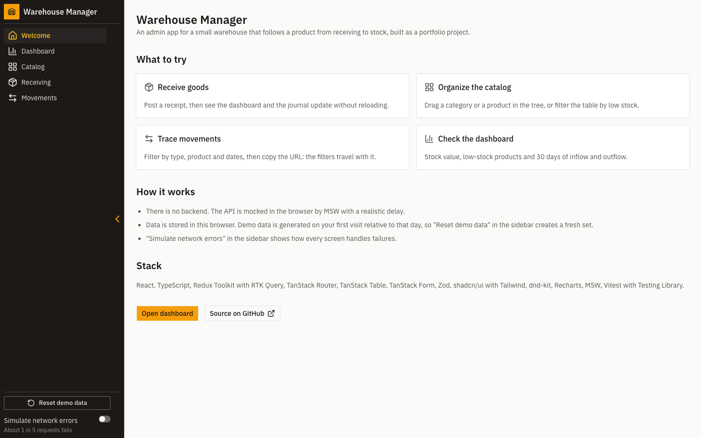
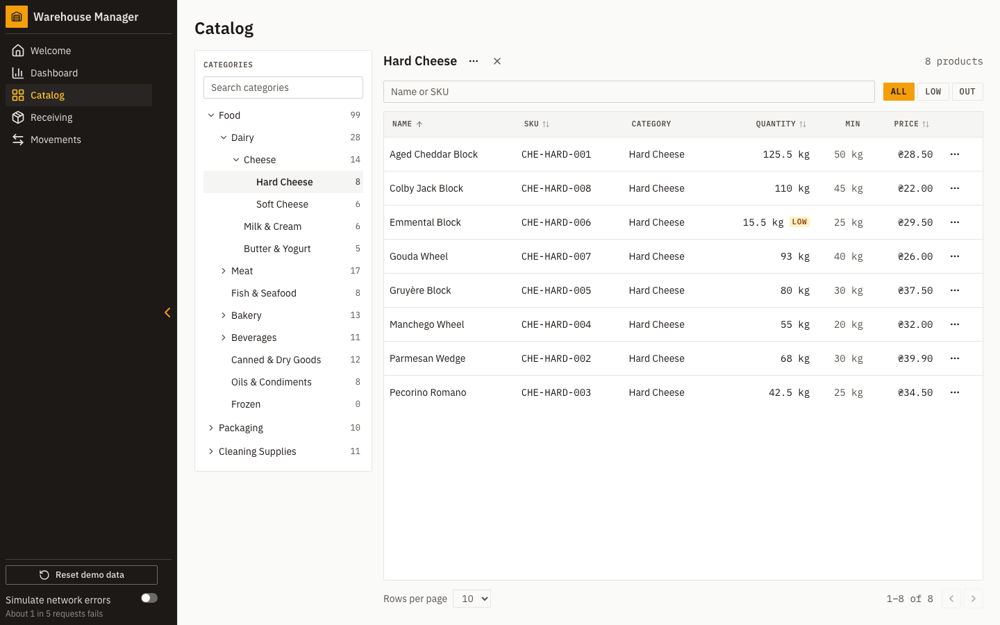
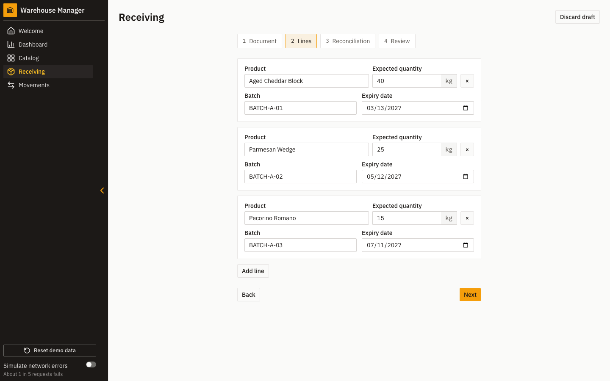
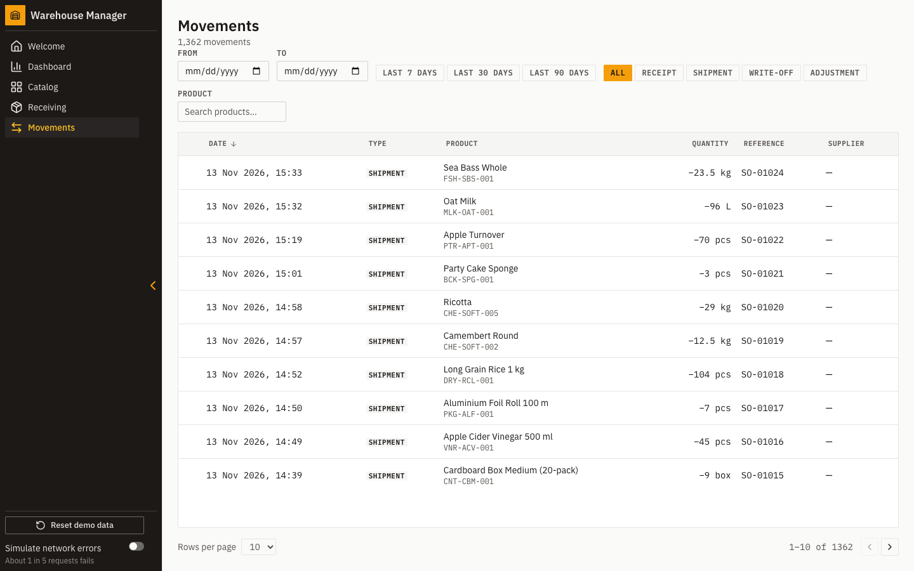
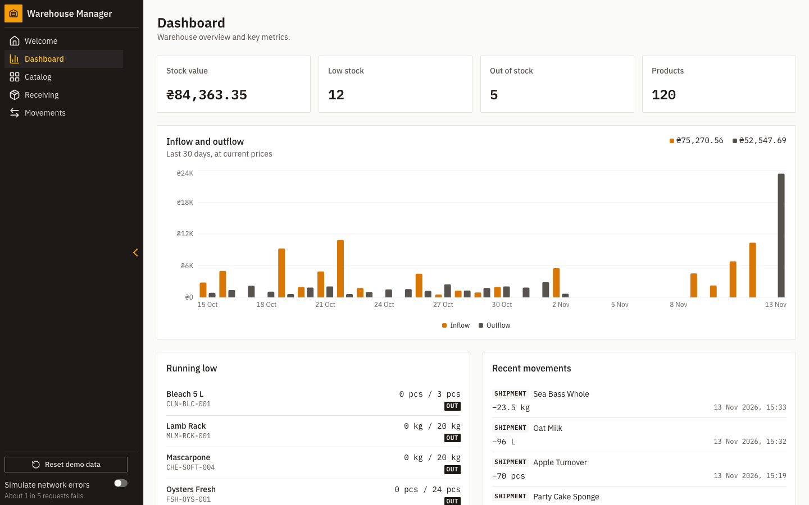

# Warehouse Manager

An inventory admin SPA for a small warehouse that follows a product from receiving to stock. The UI imitates the back-office tool a stockroom manager would use: a category tree with a paginated catalog, a four-step receiving wizard, a journal of stock movements, and a dashboard. There is no backend — the API is simulated in the browser by [MSW](https://mswjs.io/), seed data is generated on first visit, and every mutation is persisted to `localStorage`. The project is a portfolio piece, not a product.

## Live demo

<https://warehouse-manager-demo.vercel.app>

Demo data is generated on your first visit (dates are relative to that day) and lives in this browser's `localStorage`. Use **Reset demo data** in the sidebar footer to drop everything and re-seed. The **Simulate network errors** switch next to it flips the mock API into a mode where roughly one in five requests fails, so you can see how every screen handles errors.

## Screenshots





|                                                                                                                                                               |                                                                                                                  |
| ------------------------------------------------------------------------------------------------------------------------------------------------------------- | ---------------------------------------------------------------------------------------------------------------- |
|  |  |



## Features

### Catalog (`/catalog`)

- Nested tree of categories with product counts (the seed covers four levels, from Food down to Hard Cheese); selecting a category auto-expands its ancestors.
- Server-side paginated products table with sort on name, SKU, quantity and price.
- Filter by name or SKU and by stock status (All / Low / Out). The `stockStatus` rule in `src/domain` is the single source of truth for Low and Out across the table, the filter and the dashboard.
- Moves work two ways: drag-and-drop in the tree (a category under a new parent, or a product onto another category) and a keyboard-accessible "Move to category…" dialog opened from the product row "⋯" menu and from the selected category header's "⋯" button. Moves are applied optimistically and roll back on failure.

### Receiving (`/receiving`)

- Four-step wizard — Document, Lines, Reconciliation, Review — with per-step zod validation.
- The draft is persisted in `localStorage` and restored on reload, so a half-filled receipt survives a refresh.
- Leaving the page while a draft is in progress triggers a TanStack Router `useBlocker` prompt with three choices: Stay, Discard and leave, Keep draft and leave.
- Reconciliation lets you record an actual quantity that differs from the expected one; when they differ a note is required. Posting creates one `receipt` movement per line, with the line's actual quantity, batch and expiry on perishable products, and the expected quantity and discrepancy note stored on the movement itself — there is no separate adjustment movement.
- Duplicate invoice numbers return a 409 `DUPLICATE_INVOICE` which is surfaced as a field error on the Document step.

### Movements (`/movements`)

- Journal of every stock movement: `RECEIPT`, `SHIPMENT`, `WRITE-OFF`, `ADJUSTMENT`.
- Filters for date range (plus Last 7 / 30 / 90 day shortcuts), type and product.
- All filters, sort and pagination state live in the URL, so a filtered view is shareable by copying the link.
- Server-side pagination with prefetch on route load.

### Dashboard (`/dashboard`)

- Metric cards for total stock value, low-stock count, out-of-stock count and product count.
- 30-day inflow / outflow bar chart in local calendar days; inflow counts receipts, outflow counts shipments and write-offs, adjustments are excluded.
- Running-low panel showing the five products with the lowest stock-to-minimum ratio.
- Recent movements panel showing the five most recent entries.

## Tech stack

| Layer       | Choice                                                               | Why                                                                                |
| ----------- | -------------------------------------------------------------------- | ---------------------------------------------------------------------------------- |
| Build       | [Vite](https://vite.dev/) 8                                          | Fast dev server with HMR and a code-split production build.                        |
| Language    | React 19, TypeScript 6                                               | Strict TypeScript (on by default in TS 6).                                         |
| State       | [Redux Toolkit](https://redux-toolkit.js.org/) + RTK Query           | Server data via RTK Query cache tags; client state in slices.                      |
| Routing     | [TanStack Router](https://tanstack.com/router)                       | File-based routes with typed search params and per-route code splitting.           |
| Tables      | [TanStack Table](https://tanstack.com/table)                         | Headless server-side table (sort, pagination driven by URL).                       |
| Forms       | [TanStack Form](https://tanstack.com/form) + [zod](https://zod.dev/) | Per-step validation using zod schemas from `src/domain/receiving.ts`.              |
| Drag & drop | [dnd-kit](https://dndkit.com/)                                       | Accessible pointer/keyboard drag-and-drop for the category tree.                   |
| Charts      | [Recharts](https://recharts.org/) 3                                  | Composable chart primitives wrapped by shadcn's `ChartContainer`.                  |
| UI          | Tailwind CSS 4 + [shadcn/ui](https://ui.shadcn.com/)                 | Theme tokens in `src/index.css`, light-only Warehouse look.                        |
| Mock API    | [MSW](https://mswjs.io/) 3                                           | A Service Worker intercepts `fetch`, so the same mock runs in dev, tests and prod. |
| Unit tests  | [Vitest](https://vitest.dev/) + React Testing Library + MSW          | Jsdom + MSW at the network boundary; no component-level mocking.                   |
| E2E         | [Playwright](https://playwright.dev/)                                | Chromium and Firefox against the real production build (`vite preview`).           |
| Hosting     | [Vercel](https://vercel.com/)                                        | Static hosting; `vercel.json` adds an SPA rewrite plus security and cache headers. |

## Architecture notes

### MSW in the production build

Requests flow through **MSW handler → `route()` (network simulation, zod validation, error mapping) → controller (pure function over the in-memory db)**. The same handlers run in dev, in unit tests via `setupServer`, and in production via the Service Worker — the only thing the client ever talks to is `fetch("/api/…")`. The MSW bundle is heavy (`tldts`, `tough-cookie`, `@mswjs/interceptors`), so it is loaded as a lazy chunk kicked off from `main.tsx` without blocking the first paint; `baseQuery` awaits a `mocksReady` promise before every request. See `src/mocks/`.

### RTK Query cache tags and optimistic updates

`src/api/baseApi.ts` declares four tag types — `Category`, `Product`, `Supplier`, `Movement`. Each list query provides `{ type, id: "LIST" }` plus one tag per item id, and mutations invalidate the smallest tag set that covers them. The two move mutations — moving a product to another category (`updateProduct`) and reparenting a category (`moveCategory`) — apply an optimistic `updateQueryData` patch to the affected caches in `onQueryStarted` and `undo()` the patch when the server rejects the write; they always invalidate their tags so the cache is reconciled with the server either way. The `postReceipt` mutation, by contrast, invalidates the receipt's product tags and `Movement` on success and returns `[]` on error, so a failed write never invalidates cached data. See `src/api/endpoints/`.

### URL as the source of truth

Filters, sort and pagination for the catalog and the movements journal are TanStack Router search params, validated by zod schemas that use `.catch` so invalid values are dropped, with defaults stripped from the URL via `stripSearchParams`. A single `applySearchPatch` helper centralises the "changing any filter resets the page" rule, so no route hardcodes the list of keys that reset pagination. See `src/features/catalog/catalogSearch.ts`, `src/features/movements/journalSearch.ts` and `src/lib/search.ts`.

### Receiving draft persistence and the route blocker

The receiving wizard keeps its draft in a Redux slice that is debounced to `localStorage` under `warehouse-manager:receiving-draft`. A TanStack Router `useBlocker` flushes the pending write and checks whether the draft is non-empty before letting the user navigate away; the prompt is a shadcn `AlertDialog` offering Stay, Discard and leave, or Keep draft and leave. See `src/features/receiving/`.

### Versioned localStorage envelopes

The seeded db and the receiving draft are both serialised inside a versioned envelope `{ version, data }` validated by zod on load. If the shape changes, bumping `DB_VERSION` in `src/mocks/db/storage.ts` (or `DRAFT_VERSION` in `src/features/receiving/draftStorage.ts`) rejects the old payload at parse time, which is treated as "no persisted state" and the app re-seeds.

## Quality

- **664 unit tests** across **61 files** (Vitest + React Testing Library + MSW, run with `pnpm test`).
- **16 E2E tests in 6 spec files**, run in Chromium and Firefox (32 runs total) against the production build served by `vite preview`.
- **Accessibility:** `e2e/a11y.spec.ts` runs axe with the WCAG 2.1 A and AA tags on 9 states — the welcome page, the dashboard, the catalog, the receiving Document step, the receiving Lines step, the movements journal, the "Move to category" dialog, the "Reset demo data" alert dialog, and the mobile categories sheet — and the suite fails if any violation is reported.
- **CI** (`.github/workflows/ci.yml`) has two required jobs. `checks`: `pnpm format:check`, `pnpm lint`, `pnpm typecheck`, `pnpm test`, `pnpm build`. `e2e`: `pnpm test:e2e` inside the pinned `mcr.microsoft.com/playwright:v1.64.1-noble` image. A separate workflow validates the semantic PR title.
- **Pre-push hook** (`lefthook.yml`) runs the same five commands locally before a push leaves the machine; the pre-commit hook runs ESLint `--fix` and Prettier `--write` on staged files.

## Getting started

Requires Node 24 (see `.nvmrc`) and [pnpm](https://pnpm.io/) (the project is pinned to pnpm 12 via `packageManager`).

```bash
pnpm install
pnpm dev
```

Then open <http://localhost:5173>.

### Scripts

| Script              | What it does                                                          |
| ------------------- | --------------------------------------------------------------------- |
| `pnpm dev`          | Start the Vite dev server with HMR.                                   |
| `pnpm build`        | Type-check the project (`tsc -b`), then bundle with Vite.             |
| `pnpm preview`      | Serve the built `dist/` locally (used by the E2E suite on port 4173). |
| `pnpm lint`         | Run ESLint over the repo.                                             |
| `pnpm typecheck`    | Run `tsc -b` (no emit).                                               |
| `pnpm test`         | Run the Vitest unit suite once.                                       |
| `pnpm test:watch`   | Run the Vitest unit suite in watch mode.                              |
| `pnpm test:e2e`     | Run the Playwright E2E suite against the production build.            |
| `pnpm format`       | Format the repo with Prettier (write).                                |
| `pnpm format:check` | Check Prettier formatting.                                            |
| `pnpm prepare`      | Install lefthook Git hooks (skipped in CI).                           |

A production build with `ANALYZE=1 pnpm build` additionally writes `stats.html`, a rollup-plugin-visualizer treemap of the output chunks.

## Known limitations

- MSW ships in the production bundle. It is loaded as a lazy chunk from `main.tsx`, but the browser still has to download it (≈ 160 KB gzipped, dominated by `tldts`); an app with a real backend would not pay this cost.
- All data lives in this browser's `localStorage`. Clearing site data or opening the app in a different browser means a fresh seed; there is no sync between devices.
- No authentication and no multi-user support — the app assumes a single operator.
- English-only UI and a light theme only. The design tokens leave room for a dark theme but the `.dark` block in `src/index.css` is intentionally not populated.
- `pnpm audit` reports two findings (one moderate on `minimatch` via `typescript-eslint`, one low on `deepmerge` via `shadcn`). Both are dev-only transitive dependencies and do not ship in the production bundle.

## License

[MIT](./LICENSE).
